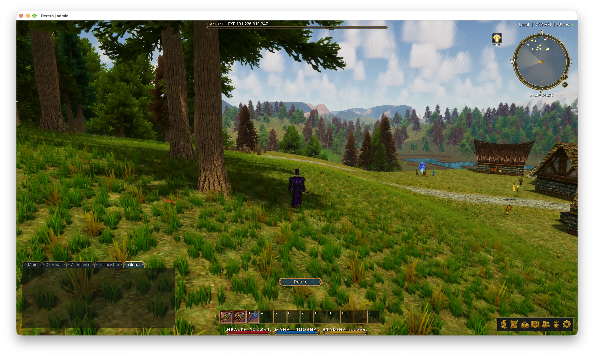

# Dereth Enhanced Environment Assets

This repository holds the assets, tools and releases of the Enhanced Environment art pack for the
[Dereth](https://github.com/dereth-network/dereth) client. The pack adds new models, ground,
materials and moons. The client draws them in place of the game's own when Enhanced Graphics is on.



## What is in the pack

`pack/manifest.toml` lists every asset, what it replaces and who made it.

| Assets | Scripts | Folder |
|---|---|---|
| Shaped models: plants, mushrooms, corals, palms, snags, embers and hay | `shapes.mjs`, `gen_pack.mjs`, `reshape.mjs`, `fit_trunks.py` | `pack/trees/` |
| Trees and bushes | `gen_pack.mjs`, `fit_trunks.py` | `pack/trees/` |
| Boulders and rocks | `boulders.py` | `pack/trees/` |
| Cactuses | `cactus.py` | `pack/trees/` |
| Ground cover | `gen_pack.mjs`, `clump_cover.py` | `pack/trees/` |
| Relief materials for walls, floors, roofs, rock and wood | `relief.py`, `masonry.py`, `recipes.py`, `split.py`, `fallback.py` | `pack/materials/` |
| Rock materials | `rockgen.py` | `pack/materials/` |
| Ice | `ice.py` | `pack/materials/` |
| Fine-detail grit tiles | `grit.py` | `pack/grit/` |
| Obsidian ground | `obsidian.py` | `pack/ground/` |
| Moons | `moons.py` | `pack/sky/` |
| Lights | By hand | `pack/manifest.toml` |

Every script is in `generators/`. Each one describes its own use at the top of the file.

## Copyright

The repository holds no picture, model or sound of the original game. Each asset is made by a
script in `generators/`, made by hand, or made with the openly licensed work in Credits. Some
assets use facts about the original game. These facts are object ids, sizes, collision positions,
overall shapes and colours. The relief materials are worked out from the player's own copy of each
original picture. The client draws them over that picture. They are of no use without the player's
own copy of the game.

`build.py` enforces these rules. It refuses the pack when an entry names no author, tool or
license. It refuses a license outside CC0-1.0 and MIT, a tool missing from `generators/`, and the
original game as an author. It also refuses any file in `pack/` that no entry names.

## Building

```bash
python3 build.py                     # checks the pack, then writes dist/enhanced-environment.dat
python3 build.py --check             # says whether dist/enhanced-environment.dat is what pack/ packs into
python3 build.py --provenance-only   # runs the checks alone
python3 build.py --dereth <checkout> # packs with dereth-art from a local dereth checkout
```

Packing needs Python 3 and a Rust toolchain. On its first run, `build.py` installs `dereth-art`
into `.tools/`. It takes `dereth-art` from the repository in `DERETH_REPO` at the commit in
`DERETH_REV`. The same `pack/` always packs into the same bytes. `--check` therefore shows that a
release matches this repository exactly. Packing reads none of the player's game files.

The generators need Node 20 or newer, Python 3 with numpy and scipy, and ImageMagick (`magick`).
Some generators read the player's own pictures or meshes of the original game, as `dereth-art`
writes them.

## Layout

| Path | What |
|---|---|
| `pack/manifest.toml` | The metadata definition. It says what each asset replaces, lists its levels of detail and credits it. It uses format 1, which the client's `core/assets/src/art_pack.rs` describes. |
| `pack/trees/` | The models (glTF 2.0) and their pictures. |
| `pack/ground/` | The ground pictures. |
| `pack/materials/` | The material pictures. |
| `pack/sky/` | The moon pictures. |
| `pack/grit/` | The shared fine-detail tiles. |
| `generators/` | The scripts that make the assets. |
| `tables/` | The measurements and recipes the generators read. |
| `licenses/` | The licenses of the outside work used here. |
| `docs/` | The README's screenshot. |
| `build.py`, `DERETH_REPO`, `DERETH_REV` | The pack's checks and build, and the dereth repository and commit it packs with. |
| `release.py`, `VERSION` | The release's version and changelog. |
| `.github/workflows/` | The release on every push to `main`, and the pull request check. |

PNG, `.bin` and `.dat` files go through Git LFS (`.gitattributes`).

## Credits

This pack uses openly licensed work. EZ-Tree's MIT license asks that its notice travels with its
work. That notice is in `licenses/EZ-Tree-MIT.txt`. The CC0 works ask for no credit. This section
credits each work.

| Work | By | License | Used for |
|---|---|---|---|
| [ambientCG](https://ambientcg.com) bark | The ambientCG authors and contributors | [CC0 1.0](https://creativecommons.org/publicdomain/zero/1.0/) | The bark of the trees and some shaped trees |
| [EZ-Tree](https://github.com/dgreenheck/ez-tree) | Daniel Greenheck | [MIT](https://github.com/dgreenheck/ez-tree/blob/main/LICENSE) | Growing the trees, and its leaf and needle pictures |
| [Stylized Nature MegaKit](https://quaternius.com) | [Quaternius](https://quaternius.com) | [CC0 1.0](https://creativecommons.org/publicdomain/zero/1.0/) | The ground cover, and the leaves of some shaped plants |

The bark reached this pack through EZ-Tree. EZ-Tree bundles ambientCG's bark textures and credits
each one in its
[texture attribution](https://github.com/dgreenheck/ez-tree/blob/main/src/app/public/textures/LICENSE.md).

## Releases

GitHub builds and releases the pack on every push to `main` that changes it
(`.github/workflows/release.yml`). The workflow packs `pack/` and checks the result with
`build.py --check`. It publishes a release when the pack differs from the last release's file.
Each release carries `enhanced-environment.dat`, its `.sha256` and `CHANGELOG.md`.

The version is `VERSION`'s major and minor numbers, then the count of commits since `VERSION` last
changed. `python3 release.py version` prints it. A hand edit to `VERSION` starts a new minor or
major version.

`release.py notes` writes each release's notes. They list the entries added, changed and removed
since the last release, the commits since then, and the `.dat` file's size and SHA-256.
`CHANGELOG.md` holds every release's notes, newest first.

Every pull request runs `build.py --provenance-only` (`.github/workflows/check.yml`). That check
needs none of the LFS files.

The client opens a release's `.dat` with `--art-pack` or from the launcher's Library.

## License

This repository is dedicated to the public domain under [CC0 1.0](LICENSE). Anyone may use it for
any purpose, with or without credit. The outside work above keeps its own license. ambientCG's and
Quaternius's work is CC0. EZ-Tree's work is MIT (`licenses/EZ-Tree-MIT.txt`).
