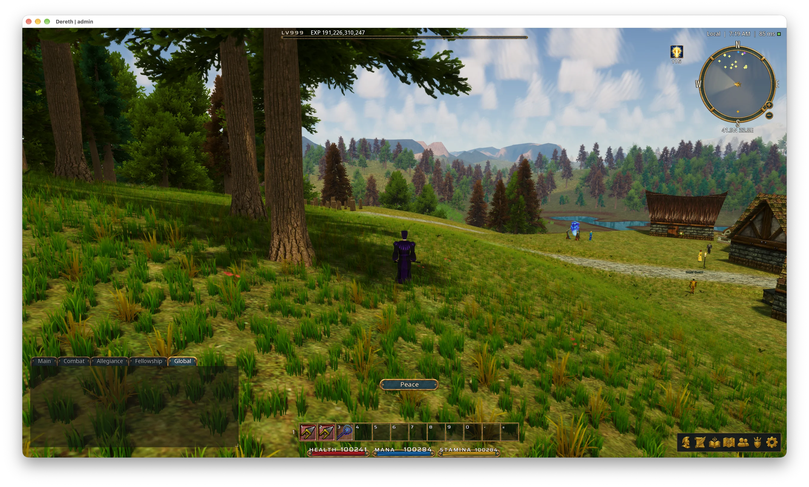

# Dereth Enhanced Environment Assets

This repository holds the assets, tools and releases of the Enhanced Environment art pack for the
[Dereth](https://github.com/dereth-network/dereth) client. The pack adds new models, ground,
materials, moons and waterfalls. The client draws them in place of the game's own when Enhanced
Graphics is on.



## What is in the pack

`pack/manifest.toml` lists every asset, what it replaces and who made it.

| Assets | Scripts | Folder |
|---|---|---|
| Shaped models: plants, mushrooms, palms, dead trees, embers and hay | `shapes.mjs`, `gen_pack.mjs`, `reshape.mjs`, `fit_trunks.py`, `foliage.py` | `pack/trees/` |
| Trees and bushes | `gen_pack.mjs`, `fit_trunks.py`, `taper_trunks.py`, `foliage.py`, `grey_needles.py` (the conifers' needle picture), then `scale_models.py` once on the trees it lists, then `slim_trees.py`, which draws the grown trees with fewer triangles, then `twins.py`, which draws End of Retail's setups that build a pack tree or plant again under another id as that model | `pack/trees/` |
| Boulders and rocks | `boulders.py` | `pack/trees/` |
| Cactuses | `cactus.py` | `pack/trees/` |
| The sea anemones' pictures, drawn on the game's own anemones | `anemone.py`, after `gen_pack.mjs` | `pack/materials/` |
| Ground cover | `gen_pack.mjs`, then `clump_cover.py`, then `foliage.py` | `pack/trees/` |
| Relief materials for walls, floors, roofs, rock, carved stone, wood and books | `relief.py`, `masonry.py`, `recipes.py`, `split.py`, `fallback.py` | `pack/materials/` |
| Rock materials | `rockgen.py` | `pack/materials/` |
| Ice | `ice.py` | `pack/materials/` |
| The crystal creatures as clear crystal in their own colours: the shards and the cistern pillars | `crystals.py`, after `relief.py` | `pack/materials/` |
| Iron that shines: the doors' iron leaves and frames, and the iron bands and hinges on wood, each with a metal map where wood and iron share a picture | `iron.py`, with `relief.py` | `pack/materials/` |
| The Bottle of Crystal Champagne painted anew in place of End of Retail's dark pictures: green glass, silver foil, a black collar with a gold seal, and a gold oval frame round a plaque lettered "Dom Pyrignon, Vintage P.Y. 10", with relief and a clear map (the foil, seal and frame metal) from the same shapes | `champagne.py`, after `relief.py` | `pack/materials/` |
| The Cove Apple Wine bottle painted anew in place of End of Retail's dark brown pictures: apple-cider glass with soft highlights and a crinkled silver foil over the neck, with relief and a clear map (the foil metal) from the same shapes | `cider.py`, after `relief.py` | `pack/materials/` |
| The painted cabinet's front and side and the game's two bookshelf pictures (the wooden bookcase and the stone-framed bookshelf, which paint the same books) shaped by hand over the player's own pictures: shelves set back behind the frame, every book rounded and placed where the picture paints it, standing, leaning or lying, and the wooden frame's grain, bolts and iron corner plates | `shelves.py`, after `relief.py` | `pack/materials/` |
| The iron chest painted anew in each era: its sides, lid and lock plate at four times retail's texels, laid out as retail's so its picture coordinates fit, with bands, rivets, hinge scrolls, lid rings and rust, and relief in millimetres from the same shapes | `chest.py` | `pack/materials/` |
| Arms and armour that shine: blades, mace heads, gilt guards, grips, the heater shield and the Training Academy's two suits of plate, each with a metal map where steel or gold share a picture with leather | `arms.py`, with `relief.py` | `pack/materials/` |
| Stone for surfaces with no picture: the Bael'Zharon statues' dark red, chiselled, laid along the world's axes over the surface's own colour | `solids.py` | `pack/materials/solid/` |
| Fine-detail grit tiles | `grit.py` | `pack/grit/` |
| Obsidian ground | `obsidian.py` | `pack/ground/` |
| Moons | `moons.py` | `pack/sky/` |
| Waterfalls modelled ahead of time: where the water of each fall goes, worked out on the land in the player's own copy of the game | The client's `engine-view --bake-falls` | `pack/falls/` |
| Lights | By hand | `pack/manifest.toml` |

Every model then goes through `quantise.py`, last of all, after the scripts above. It stores
positions, normals, picture coordinates, colours and indices as smaller integers, and moves no
point more than a millimetre. A second run changes nothing. The scripts above read and write the
models as floats, so run `quantise.py pack` again after any of them.

Each model and material names the fingerprint of the original record it was made from, so a client
drawing an older era's files draws it only where that era's record is the same. Run
`pyreal-art fingerprint pack --dat-dir <your end-of-retail files>` after any of the scripts above.
It writes the fingerprint of each entry that has none, read from your own files. A fingerprint is
a fact about the original, as an id or a size is: a short hash of a picture's light and dark, or of
a model's part sizes. The plants (`gen_pack.mjs`) say `draws_on = "any"`, so every era draws them.
The few made for 1999 and 2005 plants and trees that end of retail drew another way under the same ids
say `draws_on = "matching"`, and their fingerprints come from the 2005 files, so end of retail keeps
its own.

### Variants

The Dereth client reads each id once in `[[model]]` and `[[material]]` and ignores fingerprints, so
those tables hold one entry for each id, the first listed. For a material that is end of retail's.
For the six trees end of retail builds another way under the same ids, it is the 1999 and 2005 tree,
which Pyreal also draws where an era's files hold no record of the id. Every other entry for the same
id, another era's tree or picture or a golem's or crystal's picture in another palette, goes under
`[variant]`, as `[[variant.model]]` with its `[[variant.model.lod]]` tables, or `[[variant.material]]`.
The entries there are written exactly as in the main tables. Dereth doesn't read `[variant]`. Pyreal
reads the variants after the main tables, as if they were listed after them, so it draws the same
entry for each record in every era, and an id's entries share the card (the far picture) of the last.

`generators/variants.py` keeps the manifest that way. The Python generators read the manifest
through its `flat()` and write it through its `settle()`, which moves each repeat under `[variant]`,
`gen_pack.mjs` writes an id's later rows there itself, and
`python3 generators/variants.py pack/manifest.toml` settles the manifest after any other edit.
`build.py` refuses a manifest that lists an id twice in `[[model]]` or `[[material]]`, which
Dereth would refuse whole.

The materials for the 1999 and 2005 files are in `materials/1999/` and `materials/2005/`. They are
made from those files' own pictures where no material made from end of retail's pictures matches
them. `tables/eras.tsv` lists those pictures. `tables/drawn-as-eor.tsv` lists the rooms' pictures
and the props Pyreal draws with end of retail's own art beside an older world, and the older
materials the pack leaves out for them; Pyreal checks it against its own lists when it packs this
pack, and `build.py` refuses a material it leaves out. A picture with no relief has no material
either: the client draws it as retail does. To make them again:

```bash
pyreal-art pictures <a list of the era's pictures in tables/eras.tsv> --dat-dir <that era's files> --out <folder>
python3 generators/relief.py <folder> pack --survey <pictures.tsv> --into 2005
```

`--into` names the era, and the run replaces that era's materials alone. Each material names its
picture's fingerprint, which `pyreal-art pictures` writes beside the pictures.

End of retail's own ground is made the same way, in `materials/eor/`: the survey sees only what
models draw, so the terrain pictures no surveyed material covers are listed in `tables/eras.tsv`
as era `eor`, marked `ground:<recipe>`. Their maps are 512 texels, with a fine grain from the
ground recipes (grass, soil, sand, snow, stony) laid over each picture's own forms. Make them with
`--into eor` from end of retail's files, with no `--survey`. The 1999 and 2005 worlds lay end of
retail's ground pictures, toned toward 1999 by the client's Ground Coloring, so they take these
too and have no ground of their own.

A change to relief is checked against the maps it replaces before it is kept:

```bash
python3 generators/check_relief.py <the player's pictures> <old pack folder> <new pack folder> [--sub 2005/]
```

It says, for each picture, whether the new height is no worse than the old: its joints and cracks
lie on the picture's own lines as well as before, it dips no more where the picture is plain, and
it is flat only where the old height was clearly broken. `generators/refit.py` refits the rock and
masonry rectangles of hand recipes whose maps blotch smooth stone and plaster.

The waterfall models are made by Pyreal's `engine-view --bake-falls <file>`, run at each place on
End of Retail's files.

Every script is in `generators/`. Each one describes its own use at the top of the file.

## Copyright

The repository holds no picture, model or sound of the original game. Each asset is made by a
script in `generators/`, made by the client's `engine-view`, made by hand, or made with the openly
licensed work in Credits. Some
assets use facts about the original game. These facts are object ids, sizes, collision positions,
overall shapes and colours. The relief materials are worked out from the player's own copy of each
original picture. The client draws them over that picture. They are of no use without the player's
own copy of the game. The waterfall models are worked out from the land in the player's own copy.
They say where each fall's water goes, and the client draws them only on that land.

`build.py` enforces these rules. It refuses the pack when an entry names no author, tool or
license. It refuses a license outside CC0-1.0 and MIT, a tool missing from `generators/`, and the
original game as an author. A waterfall model's tool is the client's `engine-view --bake-falls`.
It also refuses any file in `pack/` that no entry names.

## Building

```bash
python3 build.py                     # checks the pack, then writes dist/enhanced-environment.dat
python3 build.py --check             # says whether dist/enhanced-environment.dat is what pack/ packs into
python3 build.py --provenance-only   # runs the checks alone
python3 build.py --layout 2          # writes each record compressed with zstd
```

Packing needs Python 3 and a Rust toolchain. `build.py` builds `ee-pack`, the packer in `packer/`,
with `cargo build --release --locked`, then packs with it. `packer/rust-toolchain.toml` names the
Rust version, and `packer/Cargo.lock` the version of every crate. The packer is Pyreal's own
packing code, copied into this repository: it reads the pack as the client reads it, and writes
the same file Pyreal's `pyreal-art pack` writes, byte for byte. It needs nothing else of Pyreal.

`--layout` picks how each record is stored. Layout 1, the default, stores it as it is. Layout 2
stores it compressed with zstd where that is shorter, which is how Pyreal carries its base pack.
The same `pack/` always packs into the same bytes. `--check` therefore shows that a release
matches this repository exactly. Packing reads none of the player's game files.

The generators need Node 20 or newer, Python 3 with numpy and scipy, and ImageMagick (`magick`).
Some generators read the player's own pictures or meshes of the original game, as `dereth-art`
writes them.

## Layout

| Path | What |
|---|---|
| `pack/manifest.toml` | The metadata definition. It says what each asset replaces, lists its levels of detail and credits it. It uses format 1, which the client's `core/assets/src/art_pack.rs` describes, with era variants under `[variant]` (see Variants). |
| `pack/trees/` | The models (glTF 2.0) and their pictures. |
| `pack/ground/` | The ground pictures. |
| `pack/materials/` | The material pictures. |
| `pack/sky/` | The moon pictures. |
| `pack/falls/` | The waterfall models. |
| `pack/grit/` | The shared fine-detail tiles. |
| `generators/` | The scripts that make the assets. |
| `tables/` | The measurements and recipes the generators read. |
| `licenses/` | The licenses of the outside work used here. |
| `docs/` | The README's screenshot. |
| `build.py` | The pack's checks and build. |
| `packer/` | The packer, `ee-pack`, which `build.py` builds and runs. |
| `release.py`, `VERSION` | The release's version and changelog. |
| `.github/workflows/` | The release on every push to `main`, and the pull request check. |

PNG, `.bin` and `.dat` files go through Git LFS (`.gitattributes`).

## Credits

This pack uses openly licensed work. EZ-Tree's MIT license and Pinyon Script's Open Font License
ask that their notices travel with their work. Those notices are in `licenses/EZ-Tree-MIT.txt` and
`licenses/PinyonScript-OFL.txt`. The CC0 works ask for no credit. This section
credits each work.

| Work | By | License | Used for |
|---|---|---|---|
| [ambientCG](https://ambientcg.com) bark | The ambientCG authors and contributors | [CC0 1.0](https://creativecommons.org/publicdomain/zero/1.0/) | The bark of the trees and some shaped trees |
| [EZ-Tree](https://github.com/dgreenheck/ez-tree) | Daniel Greenheck | [MIT](https://github.com/dgreenheck/ez-tree/blob/main/LICENSE) | Growing the trees, and its leaf and needle pictures |
| [Pinyon Script](https://github.com/SorkinType/Pinyon) | The Pinyon Project Authors | [SIL Open Font License 1.1](https://openfontlicense.org) | The lettering on the champagne's label (`generators/fonts/`) |
| [Stylized Nature MegaKit](https://quaternius.com) | [Quaternius](https://quaternius.com) | [CC0 1.0](https://creativecommons.org/publicdomain/zero/1.0/) | The ground cover, and the leaves of some shaped plants |

The bark reached this pack through EZ-Tree. EZ-Tree bundles ambientCG's bark textures and credits
each one in its
[texture attribution](https://github.com/dgreenheck/ez-tree/blob/main/src/app/public/textures/LICENSE.md).

## Releases

GitHub builds and releases the pack on every push to `main` that changes it
(`.github/workflows/release.yml`). The workflow packs `pack/` and checks the result with
`build.py --check`. It publishes a release when the pack differs from the last release's file.
Each release carries `enhanced-environment.dat`, its `.sha256` and `CHANGELOG.md`. It also carries
`enhanced-environment.dat.xz`, the same file compressed with xz for a smaller download, and its
`.sha256`. `xz -d enhanced-environment.dat.xz` or 7-Zip gives back the `.dat`.

The version is the one written in `VERSION` (major.minor.patch), and `python3 release.py version`
prints it. Raise it by hand in the commit that should become a release. A push whose version is
already released publishes nothing, so a change to the pack without a new version waits for the
next one.

`release.py notes` writes each release's notes. They list the entries added, changed and removed
since the last release, the commits since then, and the `.dat` file's size and SHA-256.
`CHANGELOG.md` holds every release's notes, newest first.

Every pull request runs `build.py --provenance-only` (`.github/workflows/check.yml`). That check
needs none of the LFS files.

The client opens a release's `.dat` with `--art-pack` or from the launcher's Library.

## License

This repository is dedicated to the public domain under [CC0 1.0](LICENSE). Anyone may use it for
any purpose, with or without credit. The packer in `packer/` is copied from Pyreal and is MIT, as
Pyreal is (`packer/LICENSE`). The outside work above keeps its own license. ambientCG's and
Quaternius's work is CC0. EZ-Tree's work is MIT (`licenses/EZ-Tree-MIT.txt`). Pinyon Script is
under the SIL Open Font License (`licenses/PinyonScript-OFL.txt`).
